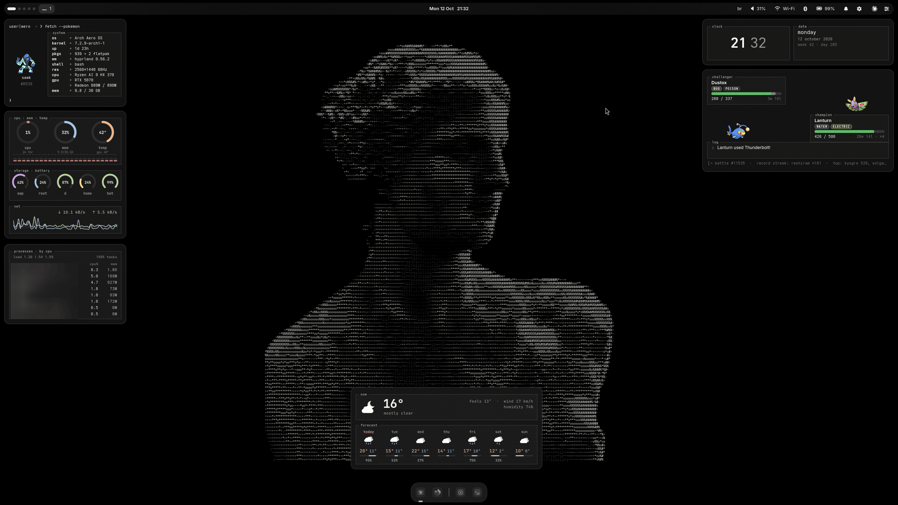
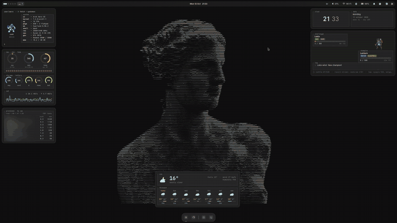
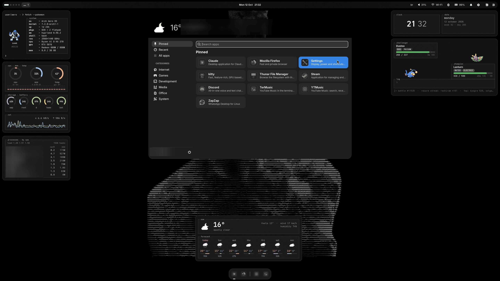
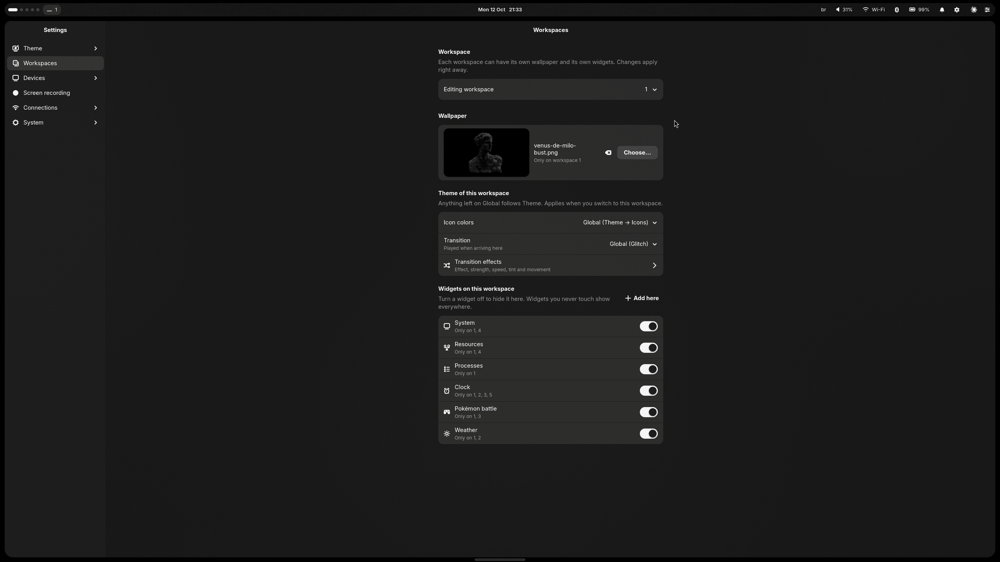
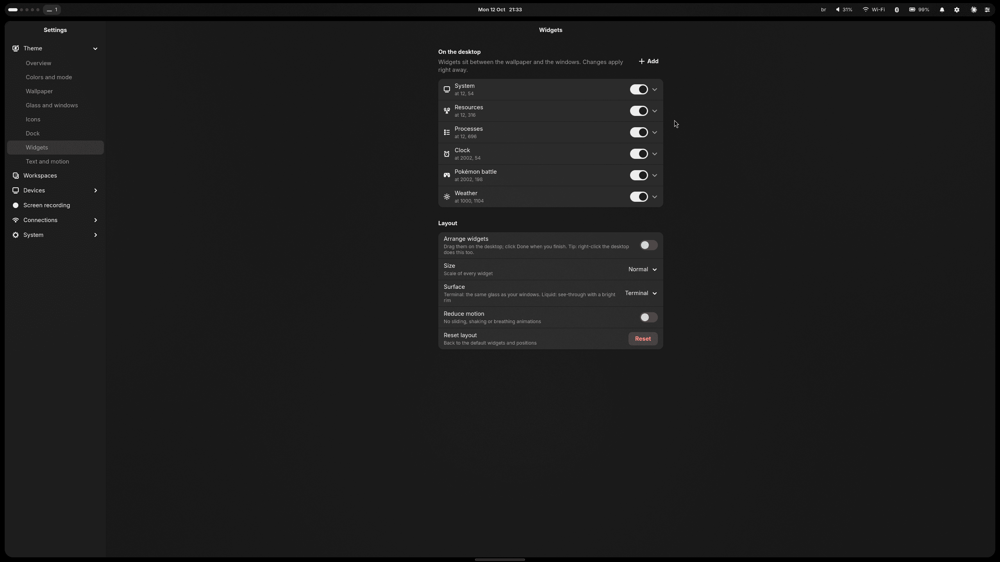
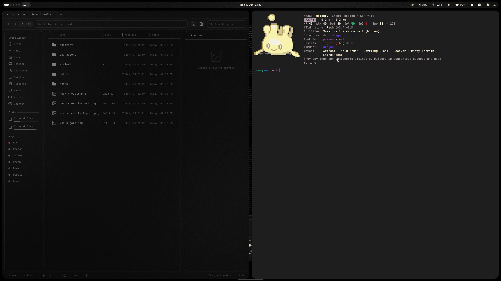

<div align="center">

```
   ▄▀█ █▀█ █▀▀ █ █   ▄▀█ █▀▀ █▀█ █▀█   █▀█ █▀
   █▀█ █▀▄ █▄▄ █▀█   █▀█ ██▄ █▀▄ █▄█   █▄█ ▄█
```

**A hand-shaped Arch Linux + Hyprland desktop.** Glass, terminal aesthetics, tiling by default.

<sub>built by someone who is not much of a coder, with prompt engineering and programming logic</sub>

</div>



## What is in here

| Folder | What it is | Installs to |
|---|---|---|
| `shell/` | the desktop shell (Python + GTK4 + layer-shell): dock, Super menu, Alt+Tab, tray, sound/quick center, clipboard history, emoji picker, power menu and the **widgets** | `~/.local/share/aero-shell` |
| `settings/` | the **Settings** app (libadwaita): theme, icons, dock, widgets, workspaces and transitions, display, sound, keyboard, mouse, screen recording, network, bluetooth, power, location, updates | `~/.local/share/aero-settings` |
| `bin/` | small commands the desktop calls (maximize/minimize to the dock, theme switcher, wallpaper, screenshots, screen recording, pokefetch...) | `~/.local/bin` |
| `config/` | Hyprland, Waybar, kitty, mako, wofi, GTK overrides | `~/.config` |
| `file-manager/` | a modified fork of [EZ File Manager](https://github.com/TechyTechster/ez-fm) (MIT), also used as the system **file picker** through xdg-desktop-portal | `~/.local/share/ez-fm` |
| `music/` | TerMusic / YTMusic: a YouTube Music engine (mpv + ytmusicapi) with a terminal UI and a GTK app | `~/.local/share/ytmotor` |
| `login/` | the greetd login screen (GTK, runs in its own Hyprland) | `/etc/greetd` |
| `system/` | hardware snippets used on the original laptop (hybrid AMD + NVIDIA) | `/etc/...` |

Code comments are in Portuguese; everything on screen is in English.

## Tour



**Workspaces with a personality.** Each of the 5 workspaces can have its own wallpaper and its own widgets
(**Settings → Workspaces**), and switching plays a transition: glitch, ASCII, pixelate or flash, with speed,
strength and tint (`shell/transitions/<effect>/`, run by `bin/hypr-transitions`; Hyprland screen shaders with no
`time` uniform, so damage tracking stays on).

**Widgets.** Clock, System (a live fetch), Resources (rings, gauges, network curves), Processes (a live top),
Weather (7 days) and an endless **Pokémon auto-battle** with type chart, crits and a scoreboard. They sit inside
Hyprland's own gaps, share the windows' glass and cost almost no CPU when idle. Each has a *Private* switch for screenshots.


**Super menu**: pinned, recent, categories, search, and the weather on top of the wallpaper.




**ASCII icons.** One switch turns every app icon (menu, dock, Alt+Tab) into a monochrome ASCII tile with a
phosphor glow. It runs once, remembers what it did, converts new apps at login and restores the originals when
turned off. **Settings → Icons** also picks the icon pack underneath, installs packs (folders or archives of any
size) and gives any single app its own image (`shell/icones.py`, command `aero-icones`).




**Settings → Widgets**: add, remove, arrange, scale, pick the glass surface.



**Screen recording**: Ctrl+Shift+Print pops a card: **1** for the whole screen or **2** to drag an area; the same
shortcut stops it. Ctrl+Print goes straight to the area. NVENC when available, computer sound and/or microphone,
24/30/60 fps; **Settings → Screen recording** has quality, format, countdown and the folder.

**Files** with big thumbnails (Ctrl + scroll), a resizable preview pane, and the same window as the system file picker.




**Also:** Alt+Tab like Windows with live thumbnails, a dock with intellihide, a wave effect and minimize-to-icon
animations, one theme color for the whole system with light/dark by time.

<sub>Screenshots and GIF: wallpapers from [ascii-walls](https://github.com/Sapyst/ascii-walls). Process names,
places and personal items are blurred.</sub>

## Principles

- **Tiling first.** Windows tile; only Super+V (or a dialog) floats one. Maximize is Hyprland's own `fullscreen 1`.
- **Glass, not plastic.** Theme color at ~62% + Hyprland blur, 1px light outline, straight inner lines.
- **Terminal soul.** Mono type, TUI frames with the title in the border, pastel accents, no emoji in the UI.
- **Cheap when idle.** Pre-rendered glass, GLib timers instead of per-frame CSS, caches everywhere.

## Requirements (what the original machine runs)

Arch Linux, Hyprland 0.56, hyprpaper, hypridle/hyprlock, waybar, mako, wofi, kitty, greetd,
python-gobject, gtk4, libadwaita, gtk4-layer-shell, python-cairo, grim/slurp, wl-clipboard,
pipewire/wireplumber, brightnessctl, networkmanager, bluez, electron + nodejs (file manager),
mpv + yt-dlp + python-ytmusicapi (music), cava (visualizer).

There is no one-click installer on purpose: this is one person's desktop, tuned to one laptop.
Read [`install.md`](install.md), take what you like, and adapt paths and hardware bits (`system/`, `config/hypr/`).

## Credits

- [EZ File Manager](https://github.com/TechyTechster/ez-fm) — MIT, © TechyTechster (license kept in `file-manager/LICENSE`)
- Weather: [Open-Meteo](https://open-meteo.com) · Pokémon data and sprites: [PokéAPI](https://pokeapi.co), downloaded at install time, not shipped here
- Pokémon is © Nintendo / Game Freak / The Pokémon Company; this is a non-commercial fan feature
- [Hyprland](https://hyprland.org), [hyprbars](https://github.com/hyprwm/hyprland-plugins)

## License

MIT for everything written here (see `LICENSE`); `file-manager/` keeps its own MIT notice.
