<div align="center">

```
   ▄▀█ █▀█ █▀▀ █ █   ▄▀█ █▀▀ █▀█ █▀█   █▀█ █▀
   █▀█ █▀▄ █▄▄ █▀█   █▀█ ██▄ █▀▄ █▄█   █▄█ ▄█
```

**A hand-shaped Arch Linux + Hyprland desktop.** Dots, bubbles and halftone light; tiling by default.

<sub>built by someone who is not much of a coder, with prompt engineering and programming logic</sub>

</div>

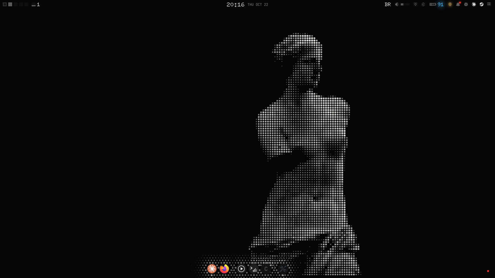

## What is in here

| Folder | What it is | Installs to |
|---|---|---|
| `shell/` | the desktop shell (Python + GTK4 + layer-shell): **AeroBar** (top bar), **Hermes** (notifications), dock, Super menu, Alt+Tab, tray, quick center, clipboard history, emoji picker, power menu, the **widgets** and the visuals (`shell/visuais/`) | `~/.local/share/aero-shell` |
| `settings/` | the **Settings** app (libadwaita): theme, icons, dock, widgets, workspaces and transitions, display, sound, keyboard, mouse, screen recording, network, bluetooth, power, location, updates | `~/.local/share/aero-settings` |
| `bin/` | small commands the desktop calls (maximize/minimize to the dock, theme switcher, wallpaper, screenshots, screen recording...) | `~/.local/bin` |
| `config/` | Hyprland, kitty, wofi, GTK overrides (Waybar and mako configs are kept only for the older visuals) | `~/.config` |
| `file-manager/` | a modified fork of [EZ File Manager](https://github.com/TechyTechster/ez-fm) (MIT), also used as the system **file picker** through xdg-desktop-portal | `~/.local/share/ez-fm` |
| `music/` | TerMusic / YTMusic: a YouTube Music engine (mpv + ytmusicapi) with a terminal UI and a GTK app | `~/.local/share/ytmotor` |
| `login/` | the greetd login screen (GTK, runs in its own Hyprland) | `/etc/greetd` |
| `boot/` | the start-up animation: the Venus de Milo in ASCII (boot splash, login, first second of the desktop) | `/usr/share/aero` |
| `x9/` | **X9**, the admin activity log app: every sudo, pkexec and su call, who asked and what for | `~/.local/share/x9` |
| `fonts/doto/` | Doto, the dot-matrix font of DotStyle (OFL) | `~/.local/share/fonts` |
| `system/` | root parts: the X9 service, the memory guard, Btrfs snapshots, polkit rules, Wi-Fi country (`system/geo`), and hardware snippets used on the original laptop (hybrid AMD + NVIDIA) | `/etc/...`, `/usr/local` |

Code comments are in Portuguese; everything on screen is in English.

## DotStyle, the new default look

Everything is drawn in **dots**: big bright dots where something lives, smaller and fainter ones as you move away,
until they fade into the wallpaper. Nothing has a hard border; a card's edge dissolves into a halftone field.
It is now the default visual (**Settings → Theme → DotStyle (Default)**); the older ones are still there
(**AeroTerm** and **AeroCloud**, formerly AerOS).

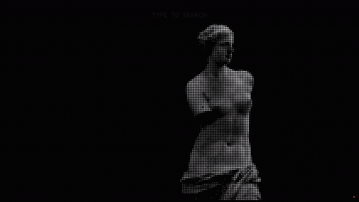

**Super menu as a bubble cloud.** Apps are round bubbles with their real, colorful icons. Moving the pointer is a
lens: bubbles near it grow and push their neighbours away so they never overlap. Around and between them a
**halftone filler** lives with its own physics: dots are pulled back to their place, pushed by the pointer and by
growing bubbles, and condense into place when the menu opens. Just type to search (`shell/nuvem.py`).

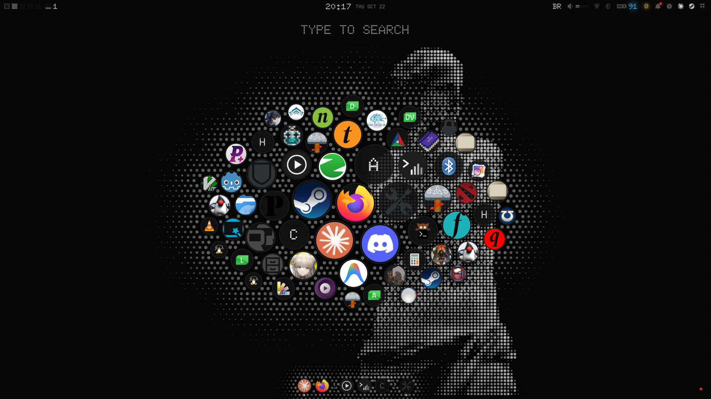

**AeroBar**, our own top bar (Waybar is gone in DotStyle). No background, no outline, no margins, rounded,
and very customizable (`~/.config/aero/aerobar.json`): modules, sizes, glow, colors. It reads the wallpaper under
it and flips to dark or light text by itself (auto-contrast), and its glow leaks softly instead of ending in a box.
The **UltraSu shield** shows the time left on the admin ticket by color only: green (more than 15 h), blue (7–15 h),
yellow (3–7 h), red (under 3 h); hover it and the hours drip down in dots. The battery pulses while charging,
goes yellow on saver and red when critical. The clock opens a calendar that closes when you click anywhere else.

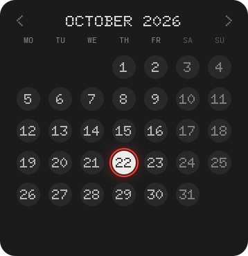

**Hermes**, our own notification daemon (replaces mako; same freedesktop D-Bus spec, so every app just works).
A notification is born as bubbles that grow into a card, and a **wave** of dots runs across the screen from the
bell: over everything, even fullscreen games (fainter there), it never dims the screen and it fades out softly.
History survives restarts, there are Do Not Disturb modes, and **Settings → Notifications** customizes all of it
(position, size, timeouts, wave strength and speed, per-app rules). `hermesctl` controls it from a terminal.

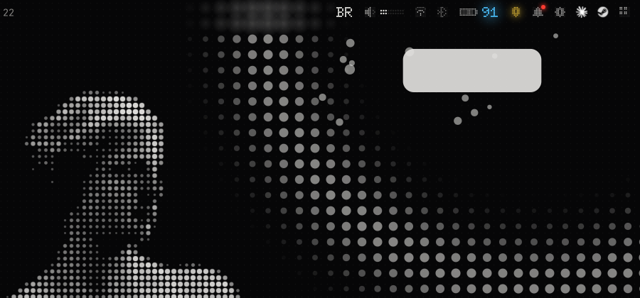
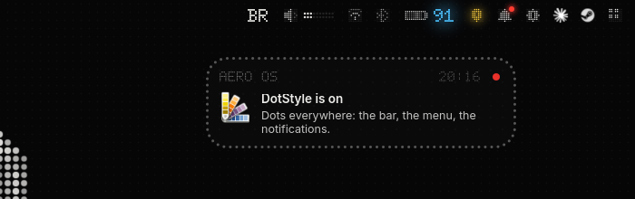

**The same field everywhere.** `shell/campo.py` wraps any popup in a live halftone field, so the quick center,
sound, Wi-Fi and Bluetooth drawers, clipboard, emoji picker, power dialog and Alt+Tab all dissolve at the edges,
pop in with a spring and dissolve outward when closed. Sliders are rows of dots, tooltips are dot bubbles, and the
dock's icons sit in bubbles with a halo. When nothing moves, nothing is drawn (0% CPU).

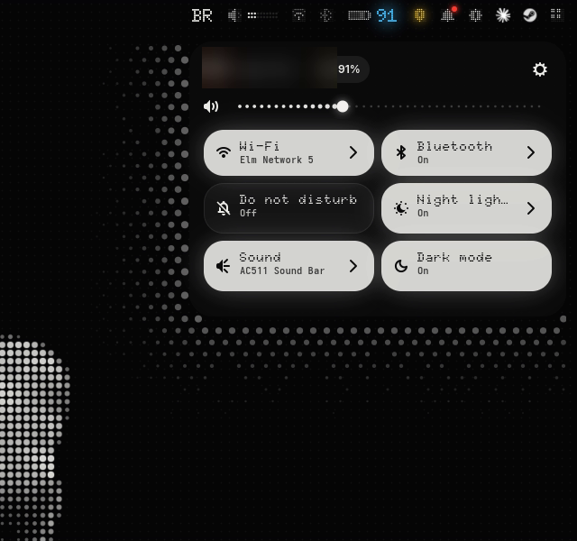

**Light on RAM.** The bar renders with GTK's cairo renderer (about 30 MB instead of 180 MB), animations stop their
frame clock at rest, and the file manager keeps one warm window for 10 minutes, so Super+E reopens in ~45 ms.

**Wi-Fi that knows where it is.** When you join a *new* network, a one-shot trigger reads the country the access
points announce (an IP lookup is optional and off by default), sets the Wi-Fi regulatory country, so 6 GHz and the right
channels show up, and exits. Nothing stays running. **Settings → Network** shows it and lets you pin a country.

## Tour

**Workspaces with a personality.** Each of the 5 workspaces can have its own wallpaper and its own widgets
(**Settings → Workspaces**), and switching plays a transition: glitch, ASCII, pixelate or flash, with speed,
strength and tint (`shell/transitions/<effect>/`, run by `bin/hypr-transitions`; Hyprland screen shaders with no
`time` uniform, so damage tracking stays on).

**Widgets.** Clock, System (a live fetch with the **Greek goddess of the day**: an ASCII statue, her name and what
she rules), Resources (rings, gauges, network curves), Processes (a live top) and Weather (7 days). They sit inside
Hyprland's own gaps, share the windows' glass and cost almost no CPU when idle. Each has a *Private* switch for screenshots.
More widgets can be dropped in: any `widget_*.py` next to the others is loaded, and a `widget_*.json` beside it adds
it to **Settings → Widgets**.

**Super menu** (AeroTerm and AeroCloud): pinned, recent, categories, search, and the weather on top of the wallpaper.

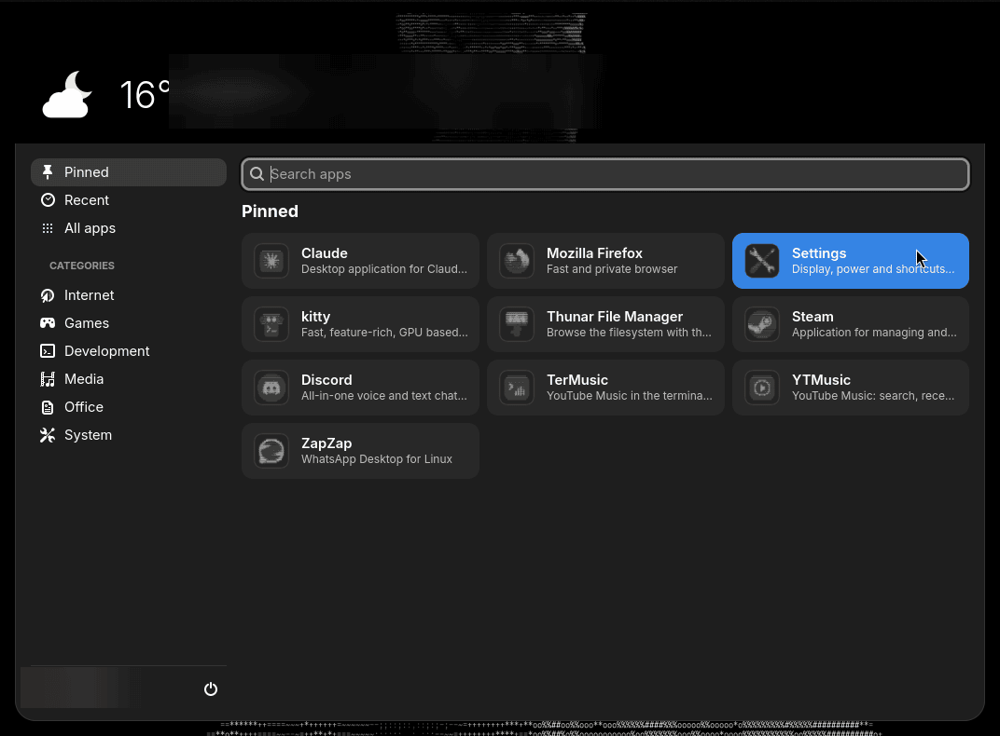

**Settings → Theme**: the whole look at once. Three visuals: **DotStyle** (the default, above), **AeroTerm** (terminal, OLED black,
ASCII and glitch) and **AeroCloud** (light pastel glass, soft corners); each remembers its own settings, so switching back restores everything.

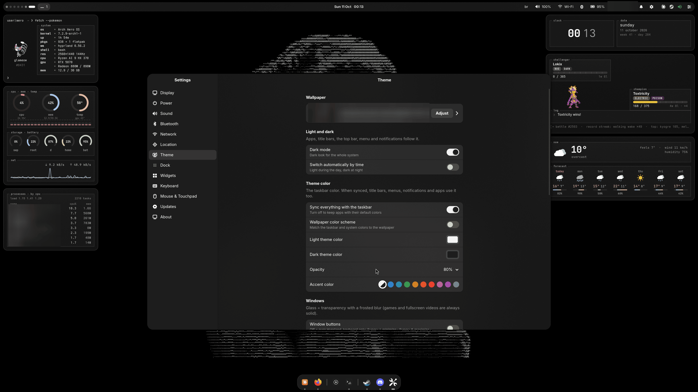

**ASCII icons.** One switch turns every app icon (menu, dock, Alt+Tab) into a monochrome ASCII tile with a
phosphor glow. It runs once, remembers what it did, converts new apps at login and restores the originals when
turned off. **Settings → Icons** also picks the icon pack underneath, installs packs (folders or archives of any
size) and gives any single app its own image (`shell/icones.py`, command `aero-icones`).

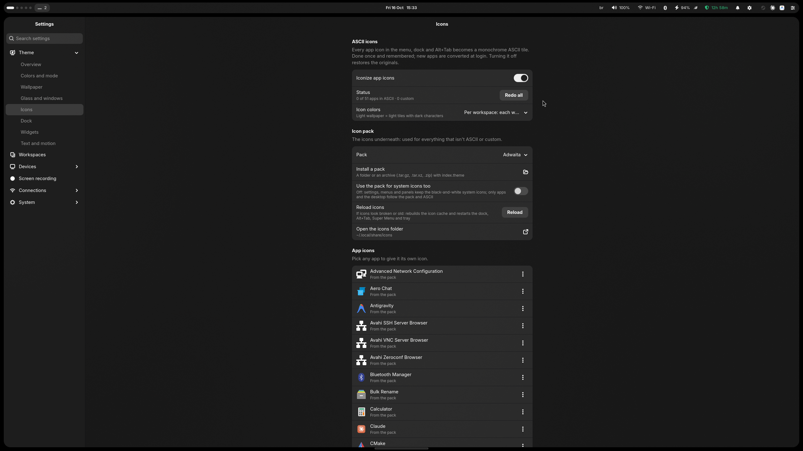

**Settings → Widgets**: add, remove, arrange, scale, pick the glass surface.

**Screen recording**: Ctrl+Shift+Print pops a card: **1** for the whole screen or **2** to drag an area; the same
shortcut stops it. Ctrl+Print goes straight to the area. NVENC when available, computer sound and/or microphone,
24/30/60 fps; **Settings → Screen recording** has quality, format, countdown and the folder.

**Files** with big thumbnails (Ctrl + scroll), a resizable preview pane, and the same window as the system file picker.

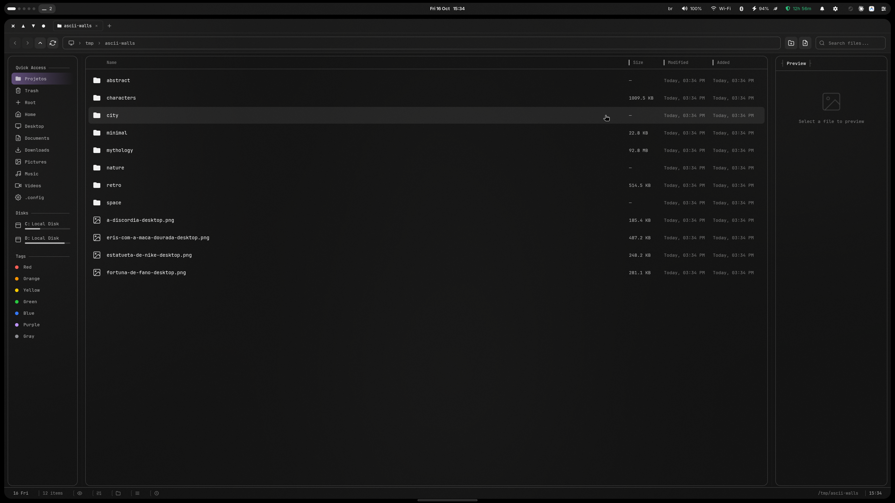

**Also:** Alt+Tab like Windows with live thumbnails, a dock with intellihide, a wave effect and minimize-to-icon
animations, one theme color for the whole system with light/dark by time.

### Safety: X9, polkit and snapshots

**X9 is the admin activity log.** (In Brazilian slang an *X9* is a snitch: it tells on whoever used root.)
A small root service follows the system journal and archives **every sudo, pkexec and su call**, one file
per day. For each call it shows:

- **when**, and **which app asked** (a terminal, Settings, Claude, Steam...), read from the app's systemd scope;
- the **command**, the folder, and whether it came from a terminal or from an app with no terminal;
- a **category** (Packages, Services, Files & config, Disks, Network, Users & security, Kernel & boot, Power,
  Root shell, Scripts & code, Inspect, Aero system...) and **what it was for** in plain words, like
  *Install packages: htop* or *Restart service: bluetooth.service*. It is a best guess from the command line;
  X9 can't see inside a script;
- a **risk** level and the **result**: allowed, denied, wrong password or cancelled.

When an app tries to reuse a cached sudo password **without asking**, the entry turns red: a normal app never
needs that. Filters combine freely: days, time of day (22:00 to 06:00 crosses midnight), category, result, risk,
app and text. Entries can be deleted one by one, several at a time or all, and auto-delete rules keep the archive
small ("keep 90 days", "delete read-only entries after 24 hours").

How it is protected:

- The app is **not root**: it only reads the archive (`/var/log/x9`, group `wheel`).
- Deleting entries or changing auto-delete goes through a root helper, and polkit asks the **admin password
  every time**. A deletion leaves a note that entries were deleted.
- Lines that only *claim* to come from sudo (`logger -t sudo ...`) are ignored: X9 trusts the real program
  that wrote them, as recorded by journald.
- The X9 password locks the app on your screen (*Forgot password?* asks the admin password to set a new one).
  It is a screen lock, not encryption.
- The service is sandboxed (no network, read-only system, writes only its own folders) and stays around 20 MB.

**Settings never uses sudo.** Every root change (power, memory, system upgrade) goes through `pkexec`, and polkit
asks the admin password **every time**, so an open sudo ticket in some terminal does not count there.

**Snapshots.** snapper + snap-pac take a Btrfs snapshot of `/` before and after every pacman change, and
`aero-snap "what" <command>` wraps any installer in a before/after pair (`sudo aero-snap undo PRE POST` puts the
files back). Bounded (10 pairs, at most 20% of the disk) and with no resident daemon. `/home` and `/var/log`
are left out on purpose, so your files and X9's log survive a rollback.

<sub>Screenshots: wallpapers from [ascii-walls](https://github.com/Sapyst/ascii-walls). Process names,
places and personal items are blurred.</sub>

## What's next

DotStyle is the direction from now on. The plan, roughly in order:

- **AeroBar page in Settings**, so every option of `aerobar.json` has a switch, and the tray following the bar.
- **System icons redrawn in dots** (Wi-Fi, sound, battery, folders), keeping real app icons colorful.
- **The bubble menu's filler** re-flowing around the results while you search.
- **Under 1 GB of RAM** for the whole desktop at idle: merging the shell's small daemons into fewer processes and
  measuring every new feature against that budget.
- **The battery charge limiter** for the Aorus laptop (a DKMS driver), shown in the battery menu.
- **Packaging**: an install script per part and, later, a package repository and an ISO.
- Hyprland is pinned at 0.56.2 while it is stable here; updates are tested before the pin moves.

## Principles

- **Tiling first.** Windows tile; only Super+V (or a dialog) floats one. Maximize is Hyprland's own `fullscreen 1`.
- **Dots, not lines.** Edges dissolve into halftone; light glows instead of being boxed in.
- **Glass, not plastic** (AeroTerm/AeroCloud). Theme color at ~62% + Hyprland blur, 1px light outline.
- **Terminal soul.** Mono type, TUI frames with the title in the border, pastel accents, no emoji in the UI.
- **Cheap when idle.** Pre-rendered glass, GLib timers instead of per-frame CSS, caches everywhere.

## Requirements (what the original machine runs)

Arch Linux, Hyprland 0.56, hyprpaper, hypridle/hyprlock, wofi, (waybar and mako only for the older visuals), kitty, greetd,
python-gobject, gtk4, libadwaita, gtk4-layer-shell, python-cairo, grim/slurp, wl-clipboard,
pipewire/wireplumber, brightnessctl, networkmanager, bluez, iw + wireless-regdb, snapper + snap-pac, electron + nodejs (file manager),
mpv + yt-dlp + python-ytmusicapi (music), cava (visualizer).

There is no one-click installer on purpose: this is one person's desktop, tuned to one laptop.
Read [`install.md`](install.md), take what you like, and adapt paths and hardware bits (`system/`, `config/hypr/`).

## Credits

- [EZ File Manager](https://github.com/TechyTechster/ez-fm) — MIT, © TechyTechster (license kept in `file-manager/LICENSE`)
- [Doto](https://github.com/oliverlalan/Doto) font — SIL OFL 1.1 (license in `fonts/doto/OFL.txt`)
- Weather: [Open-Meteo](https://open-meteo.com)
- Venus de Milo (start-up animation): public-domain photo, Louvre, via Wikimedia Commons
- Goddesses of the System widget: ASCII from [ascii-walls](https://github.com/Sapyst/ascii-walls), made from photos
  that are public domain, CC0 or CC BY (no share-alike):
  - Athena: *Atena Mattei* (Paris), photo by Jastrow, Public domain · [source](https://commons.wikimedia.org/wiki/File:Mattei_Athena_Louvre_Ma530_n2.jpg)
  - Aphrodite: *Vênus de Milo* (Paris), photo by Shonagon, CC0 · [source](https://commons.wikimedia.org/wiki/File:V%C3%A9nus_de_Milo_-_Mus%C3%A9e_du_Louvre_AGER_LL_299_;_N_527_;_Ma_399.jpg)
  - Artemis: *Diana de Versalhes* (Paris), photo by Shonagon, CC0 · [source](https://commons.wikimedia.org/wiki/File:Diane_de_Versailles_-_Mus%C3%A9e_du_Louvre_AGER_Ma_589.jpg)
  - Hera: *Juno Ludovisi* (Roma), photo by , Public domain · [source](https://commons.wikimedia.org/wiki/File:Hera_Ludovisi_Altemps_Inv8631.jpg)
  - Demeter: *Deméter de Cnido* (Londres), photo by Raymond.ellis, CC0 · [source](https://commons.wikimedia.org/wiki/File:Marble_Statue_of_Demeter.jpg)
  - Hestia: *Héstia Giustiniani* (Roma), photo by Marie-Lan Taÿ Pamart, Public domain · [source](https://commons.wikimedia.org/wiki/File:Hestia_Giustiniani_Torlonia_Collection_MT490.jpg)
  - Persephone: *Grande Relevo de Elêusis (Deméter, Triptólemo e Perséfone)* (Nova York), photo by , CC BY 2.5 · [source](https://commons.wikimedia.org/wiki/File:Great_Eleusinian_relief_fragments_Met_14.130.9_n01.jpg)
  - Nike: *Vitória de Samotrácia* (Paris), photo by Shonagon, CC0 · [source](https://commons.wikimedia.org/wiki/File:Victoire_de_Samothrace_-_Musee_du_Louvre_-_20190812.jpg)
  - Tyche: *Fortuna ou Tutela (MAM 2735)* (Arles), photo by Rama, Public domain · [source](https://commons.wikimedia.org/wiki/File:Fortuna_or_Tutela-MAM_2735-IMG_9179-gradient.jpg)
  - Hygieia: *Higeia, deusa da saúde (Ra 42)* (Toulouse), photo by Didier Descouens, Public domain · [source](https://commons.wikimedia.org/wiki/File:(Toulouse)_Hygie,_d%C3%A9esse_de_la_Sant%C3%A9_-_Mus%C3%A9e_Saint-Raymond,_Ra_42.jpg)
  - Themis: *Justitia do Landgericht* (Berlim), photo by Genealogist, CC0 · [source](https://commons.wikimedia.org/wiki/File:Justitia_am_Landgericht_Berlin.JPG)
  - Hebe: *Hebe* (Copenhague), photo by Bertel Thorvaldsen, CC0 · [source](https://commons.wikimedia.org/wiki/File:Hebe_by_Bertel_Thorvaldsen_(A874).jpg)
  - Selene: *Selene deitada* (Montauban), photo by Didier Descouens, Public domain · [source](https://commons.wikimedia.org/wiki/File:Mus%C3%A9e_Ingres-Bourdelle_-_S%C3%A9l%C3%A9n%C3%A9_couch%C3%A9e,_1917_-_Bourdelle_-_Joconde06070001193.jpg)
  - Hecate: *Diana como Hécate* (Londres), photo by Unknown authorUnknown author, Public domain · [source](https://commons.wikimedia.org/wiki/File:Estatua_de_Diana_como_H%C3%A9cate,_British_Museum.jpg)
  - Nemesis: *Nêmesis alada do Egito* (Paris), photo by Gary Todd from Xinzheng, China, CC0 · [source](https://commons.wikimedia.org/wiki/File:Marble_statue_of_Nemesis,_from_Egypt,_2nd_c._AD_(28273794646).jpg)
  - Eris: *Eris com a maçã da discórdia* (Bydgoszcz), photo by Pit1233, CC0 · [source](https://commons.wikimedia.org/wiki/File:Bdg_Gdanska15_Eris_07-2013.jpg)
- [Hyprland](https://hyprland.org), [hyprbars](https://github.com/hyprwm/hyprland-plugins)

## License

MIT for everything written here (see `LICENSE`); `file-manager/` keeps its own MIT notice and `fonts/doto/` its OFL.
